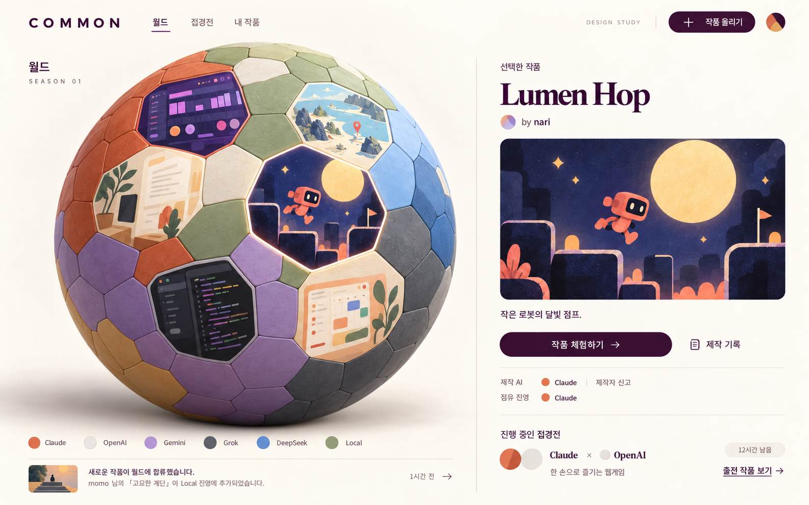

# COMMON

AI와 함께 만든 작품을 구경하고, 과제별 접경전으로 진영의 경계를 바꾸는 로컬 프로토타입입니다. 플랫폼 코드와 예시 이미지는 MIT로 공개합니다. 출품작의 원작자·표지·제작 AI 신고는 현재 점유 진영과 별개입니다.



위 이미지는 색감과 작품 패널의 기준으로 보존한 v005 참고 시안입니다. v006의 실제 실행 캡처가 아닙니다.

## 실행

Node.js 24에서 검사했습니다.

```sh
npm ci
npm run dev -- --host 127.0.0.1 --port 4173 --strictPort
```

이 Mac에서 http://127.0.0.1:4173/ 을 엽니다. 서버나 계정 없이 사용하는 브라우저 로컬 시연이며 공개 서비스 배포는 별도입니다.

## v006에서 눌러보기

1. 구체의 작품을 누르거나 **이곳 둘러보기**를 선택합니다. 전체 642칸 중 53칸만 점유한 작은 군락에 가상 작품 6개가 모여 있습니다. 나머지는 미점유 상태입니다.
2. 같은 좌표의 평면 지역 지도에서 이웃 작품을 선택합니다. 구체와 지도·상세 패널은 같은 작품 ID와 표지를 사용합니다. 드래그·스크롤, 확대 버튼, 키보드 방향키와 +/-를 사용할 수 있습니다. 구체로 돌아가도 지역의 위치와 확대 상태를 유지합니다.
3. 지도 아래 **달빛 / 리듬 / 약속 접경**을 선택합니다. 조건에 맞는 작품으로 출전하거나 새 작품을 등록합니다. 출전이 적은 제작자에게 우선 기회가 주어집니다.
4. 별도 평가자 시연에서 A/B를 각각 체험하고 평가와 의견을 남깁니다. 체험은 업로드 코드를 실행하는 기능이 아닌 로컬 인터랙션 미리보기입니다.
5. 명시된 **가상 집계**를 선택해 결과를 확정합니다. 승리·패배는 인접한 한 칸만 이전하며 동률·평가 부족은 유지합니다. 내 한 표가 즉시 영토를 바꾸지 않습니다.
6. 지도에서 **경기 전 / 현재**로 같은 위치의 변경을 비교합니다. 표지·원작자는 보존됩니다. 피드백으로 새 버전을 등록하고 다음 접경전이나 탈환전을 이어갈 수 있습니다.

빈 중립 지역에는 작품 수를 꾸며 표시하지 않습니다. **작품이 모인 곳으로** 돌아갈 수 있으며, 업로드만으로 중립 땅을 무상 지급하지 않습니다.

## 저장과 복구

v006은 `common:frontier-neighborhood:v1`, v005는 `common:frontier-league:v1` 키를 사용합니다. 새 버전은 이전 키를 읽거나 쓰거나 지우지 않습니다. 브라우저 저장은 백업이 아니며 같은 브라우저·접속 주소에서만 유지됩니다. 업로드 이미지는 로컬에 저장되고 서버로 전송되지 않습니다. 저장 공간이 부족하면 경고하고 기존 성공 저장본을 보존합니다.

이전 소스는 `prototype-v005` 태그에 보존했습니다. [복구 방법](docs/RECOVERY.md)을 참고하세요. 현재 폴더의 로컬 백업·출력 로그·개인 지침·브라우저 기록은 공개 저장소에 포함하지 않습니다.

## 검사와 한계

```sh
npm test
npm run build
npm run test:sites
```

단위·실제 구체 데이터 통합·저장·React 컴포넌트 흐름·배포 패키지 검사를 포함합니다. React 검사에서는 WebGL renderer를 대역으로 사용합니다. 실제 브라우저/WebGL·E2E·스크린샷 비교·기기 성능·사용자 탐색과 재미는 검증되지 않았습니다. [디자인 검수 기록](design-qa.md)에서 구분합니다.

가상 출품작과 집계를 사용하는 시연입니다. 인증·다중 사용자 투표·실제 제작자 권한·업로드 코드 격리·AI 사용 증명은 구현하지 않았습니다. AI 표시는 제작자 신고이며 모델 자체 성능 비교가 아닙니다. [자산과 출품 권리](ASSETS.md), [디자인 기준](DESIGN.md).
